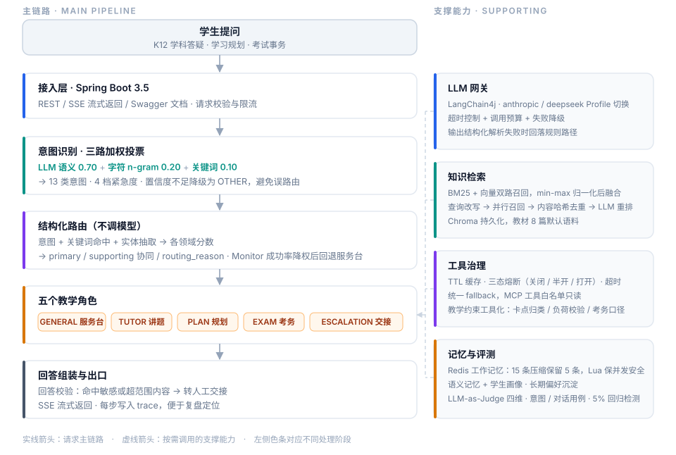

# TutorMesh Java

面向 K12 / 大学学习场景的多 Agent 辅导系统，Java 实现。

与 Python 版 [TutorMesh](https://github.com/TaoYu-ds/TutorMesh) 共用同一套意图体系（13 类）、业务场景和检索口径，用 Spring Boot 生态重新实现运行时：**LLM 只负责理解和表达，路由、工具、记忆、约束由代码控制**。



## 与 Python 版的对应关系

| 维度 | Python 版 | 本仓库（Java 版） |
| --- | --- | --- |
| Web 框架 | FastAPI | Spring Boot 3.5 |
| LLM 接入 | Anthropic SDK | LangChain4j（`anthropic` / `deepseek` Profile 切换） |
| 并发编排 | `asyncio.gather` | `CompletableFuture` |
| 向量检索 | ChromaDB | LangChain4j `EmbeddingStore`（Chroma） |
| 记忆存储 | Redis + Chroma | Redis + 本地 JSON 持久化 + Chroma |
| 意图体系 | 13 类，三路加权 0.7/0.2/0.1 | 同左，权重与分组一致 |
| 业务场景 | 教育 | 教育 |

两个版本独立可运行，意图与路由口径对齐，方便做「同一套设计换语言实现」的对照。

## 核心能力

**1. 三路融合意图识别**
13 类意图（7 个通用会话意图 + 5 个教育意图 + OTHER）。LLM 负责理解复杂表述，n-gram 相似度负责快速兜底，关键词规则负责明确的字面信号。加权投票后还有一次「细分类修正」：模型给出宽泛大类、而关键词命中具体细分类时（如「学习计划」vs「请求」），以细分类为准。

**2. 五个教学角色与结构化路由**
`GENERAL`（学习服务台）· `TUTOR`（讲题）· `PLAN`（规划）· `EXAM`（考务）· `ESCALATION`（人工交接）。
路由不是简单查表，而是算领域分数：意图权重 + 关键词命中 + 实体证据（命中章节 → 讲题，命中考试名 → 考务），再取最高分作为主角色，分数够高的次要领域作为协同角色并行处理。Monitor 根据成功率给专业 Agent 降权，降权后自动回退服务台。

**3. 混合检索**
BM25 关键词得分与向量语义得分归一化后加权融合，检索前按 metadata 过滤；对模糊提问做查询改写、多子查询并行召回、按内容哈希去重，最后 LLM 重排取 Top-K。工具层统一提供 TTL 缓存、三态熔断（5 次失败打开、60 秒半开探测）、超时与 fallback。

**4. 分层记忆**
Redis 保存当前会话工作记忆（15 条触发压缩，保留摘要 + 最近 5 条），Chroma 保存历史会话摘要与学生画像。压缩时用 Lua 脚本同时校验消息快照和旧摘要，避免并发维护覆盖；摘要失败不裁剪历史，画像提取失败保留旧值。

**5. 教学约束做成可执行工具**
这是与「只靠 prompt 约束」最大的区别——四个确定性工具全部不调模型、不访问外部系统：

| 工具 | 作用 | 约束了什么 |
| --- | --- | --- |
| `classify_blocker` | 把「我不会」归到概念/计算/审题/步骤/迁移五类，并给对应讲解策略 | 讲解必须先定位卡点，不直接给答案 |
| `build_explanation_plan` | 生成「思路 → 关键步骤 → 自检」三段脚手架 | 只给到能自己往下算的位置 |
| `check_study_load` | 按每天时长、任务数、天数算单任务时长，判断负荷 | 不排学生完不成的计划 |
| `exam_official_channels` | 给出考试对应的官方渠道 | 不编造报名日期与分数线 |

配合四份 Skills（接待 / 讲题 / 规划 / 考务）注入 system prompt，形成「代码约束 + 提示约束」两层。

**6. 可观测与评测**
Micrometer / Prometheus 暴露 Agent 与工具的成功率、延迟、连续失败次数，`monitor_penalty` 写回 Orchestrator 影响后续路由。评测侧真实调用编排器生成回答，用 LLM-as-Judge 从相关性、准确性、完整性、有用性四个维度打分，内置 11 条意图用例 + 5 条对话用例，指标退化超过 5% 标记为 regression。

## 快速开始

### Docker Compose

```bash
cp .env.example .env          # 填入 ANTHROPIC_API_KEY 或 DEEPSEEK_API_KEY
docker compose up -d
curl http://localhost:8080/health
# Swagger: http://localhost:8080/docs
```

### 本地运行

```bash
docker compose up -d redis    # Redis 映射到宿主机 6380
export REDIS_PORT=6380
./mvnw spring-boot:run
```

没有有效模型 Key 也能启动：知识库管理、健康检查、指标都可用，聊天请求会明确返回 `status=failed` + HTTP 503 + 重试信息，不会伪造回答。

### CLI

```bash
./mvnw package
java -jar target/tutormesh-java-0.1.0.jar --cli
# /new 新会话，/quit 退出
```

## API 示例

```bash
# 知识点提问
curl -X POST http://localhost:8080/chat \
  -H 'Content-Type: application/json' \
  -d '{"message":"导数为零的点一定是极值点吗","user_id":"u1","conv_id":"c1","client_request_id":"turn-1"}'

# 学习计划（会触发负荷校验工具）
curl -X POST http://localhost:8080/chat \
  -H 'Content-Type: application/json' \
  -d '{"message":"还有十天期末，每天能学两小时，帮我排个复习计划","user_id":"u1","conv_id":"c1","client_request_id":"turn-2"}'

# 知识库
curl -X POST http://localhost:8080/knowledge/add \
  -H 'Content-Type: application/json' \
  -d '{"documents":[{"title":"函数单调性与导数","document_id":"math-monotonic","content":"先求定义域，再求导，令导数为零求分界点，按区间判断符号。"}]}'

curl -X POST http://localhost:8080/knowledge/upload -F 'file=@lesson.md'
curl -X POST 'http://localhost:8080/search?query=导数单调性&top_k=3'
```

响应包含 `request_id`、`agent_types`、`tools_used`、`entities`、`intent_embedding_source`、`status`、`retryable`、`error_code`。同一 `client_request_id` 重试会返回已完成回执，消息不同则返回 HTTP 409。

## 测试

```bash
./mvnw test
```

覆盖意图分类与投票、路由与协同、角色工具边界（跨角色调用必须失败）、熔断状态机、记忆压缩并发、MCP 白名单、写操作守卫、评测链路。当前 112 项通过、17 项跳过（跳过的是需要真实模型 Key 与 Chroma 服务的集成测试）。

## 目录结构

```
src/main/java/com/tutormesh/
├── intent/        意图识别：枚举、三路投票、实体抽取
├── agent/         教学角色、编排器、回答合成、交接摘要
├── knowledge/     知识库：切片、向量索引、混合检索
├── tool/          工具注册、熔断、白名单、教学工具
├── memory/        工作记忆、语义记忆、画像、压缩
├── skill/         Skills 加载与注入
├── evaluation/    意图评测、端到端评测、LLM-as-Judge
├── monitor/       成功率与延迟监控、路由降权
└── api/           HTTP 接口与 DTO
skills/            四份教学规范（接待 / 讲题 / 规划 / 考务）
```

## 设计取舍

**为什么 Java 版也自己写编排，而不是用 Spring AI 的 Agent 抽象？**
接手 Python 版时发现，真正影响效果的不是「调模型」这一步，而是「准入与兜底」：允许调哪些工具、最多几轮、失败怎么降级、要不要转人工。这些必须由代码掌握，所以编排器自己写，Spring AI / LangChain4j 只用在模型调用与向量检索这两层。

**为什么把教学约束做成工具而不是只写 prompt？**
prompt 约束是不可测的。把「不代写」变成 `build_explanation_plan`（返回 `final_answer_included=false`）、把「不编造日期」变成 `exam_official_channels`（返回 `date_guaranteed=false`）之后，这些约束就能被单测断言，也能在 trace 里看到有没有真的执行。

**为什么 `EscalationAgent` 不调模型？**
转人工是一个确定性动作：整理上下文、给交接摘要、告知学生下一步。让模型参与只会引入「承诺已处理」「编造工单号」这类风险，所以它只拼摘要、不调 LLM。

**为什么意图用枚举而不是字符串？**
枚举让编译器帮忙查漏：新增意图时，所有 `switch`、路由表、测试都会报错，不会出现「路由表忘了加」这种静默失败。

## 已知限制

- **知识库默认只有 8 篇教材**，够跑通链路，但不足以做效果结论。
- **默认向量模型是 `all-MiniLM-L6-v2`（英文）**，对中文教材区分度有限——这也是 Python 版接 BM25 做混合检索的直接原因。换中文 embedding（如 bge-small-zh）需要重建全部向量。
- **评测集规模小**（11 条意图 + 5 条对话），定位是回归检测，不是效果宣传。
- **不接真实教务系统**：课程表、排课、调班、退费都由人工处理，系统只给流程与渠道。
- **Windows 本地运行**需要额外指定 Redis 端口，且首次运行 Chroma 会下载 embedding 模型。

## 许可

仅供学习与技术交流使用。
